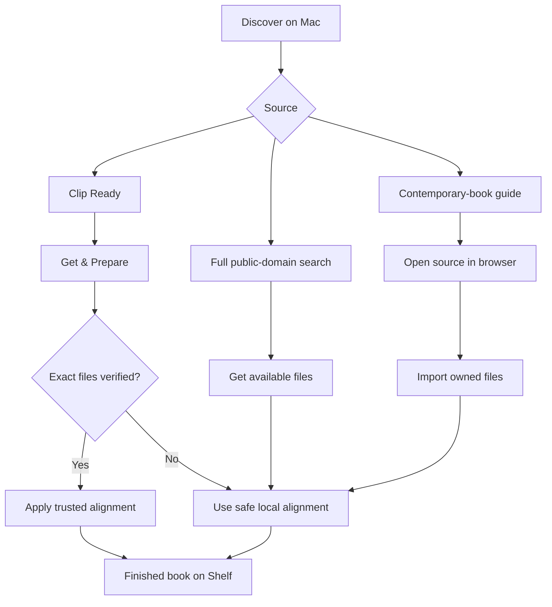

# Easier Book Discovery, Safer Alignment, and a Calmer Reader

## Problem Frame

Clip works well once a reader already has a matching EPUB and audiobook, but finding a legal, compatible pair is currently outside the product. That makes the first successful book unnecessarily difficult. Processing can also take a long time, while careless attempts to accelerate transcription could silently damage sentence timing and highlights. On iOS, the reader is functional and audio-aware, but its sentence-by-sentence presentation and persistent media controls feel closer to a transcript than a beautifully typeset book.

The highest-leverage change is to make acquisition a front porch to Clip rather than turning Clip into a bookstore: offer a dependable shelf of verified public-domain pairs, retain broad public-domain search with honest compatibility expectations, and guide owners of contemporary books to legitimate DRM-free sources. In parallel, make verified books instant to prepare, improve resumability for other books, and refresh the continuous reader without compromising Clip's audio-following and clipping identity.

The prose requirements below are authoritative if the diagram and text ever differ.

---

## Actors

- A1. Reader or listener: Discovers, prepares, reads, listens to, and clips books.
- A2. Clip: Coordinates acquisition and preparation on Mac, then reading and listening on iPhone.
- A3. Content provider: Supplies public-domain catalog metadata and files, or an external DRM-free source page.

---

## Key Flows

- F1. Get a Clip Ready book
  - **Trigger:** A reader chooses a verified title in Discover on Mac.
  - **Actors:** A1, A2, A3
  - **Steps:** The reader reviews the edition, narrator, duration, and download size; chooses **Get & Prepare**; Clip downloads the paired files, verifies their exact identity, applies the trusted alignment, and adds the completed book to the Shelf.
  - **Outcome:** The book is ready for iPhone without manual file pairing or local transcription.
  - **Covered by:** R1, R2, R3, R7

- F2. Get an unverified public-domain book
  - **Trigger:** A reader selects a title from full public-domain search.
  - **Actors:** A1, A2, A3
  - **Steps:** Clip labels the title as requiring local preparation, retrieves the available audiobook and compatible ebook when possible, asks for a user-supplied EPUB when necessary, then runs the safe local alignment path with resumable progress.
  - **Outcome:** Broad catalog access remains available without implying that unverified editions are guaranteed matches.
  - **Covered by:** R1, R4, R5, R6, R8

- F3. Bring a contemporary book
  - **Trigger:** A reader opens the compatible-source guide.
  - **Actors:** A1, A2, A3
  - **Steps:** Clip explains the formats it can use, links to legitimate DRM-free sources in the browser, and accepts the files after the reader obtains them independently.
  - **Outcome:** Clip helps the reader complete the task without handling purchases, retailer accounts, or DRM.
  - **Covered by:** R1, R6

- F4. Read continuously on iPhone
  - **Trigger:** A reader opens Read from the player.
  - **Actors:** A1, A2
  - **Steps:** Clip presents book-like paragraphs using the reader's saved theme and typography; the spoken sentence receives restrained emphasis; controls recede during reading and return on deliberate interaction; scrolling pauses audio-following until the reader returns to the spoken passage.
  - **Outcome:** Reading feels calm and literary while seeking, following audio, and clipping remain dependable.
  - **Covered by:** R12, R13, R14, R15, R16

---

## Requirements

**Mac discovery and acquisition**

- R1. Add a Mac Discover area with three clearly separated paths: a prominent **Clip Ready** shelf, secondary full public-domain search, and a concise guide to obtaining compatible contemporary books.
- R2. A catalog result must show enough information to choose the correct recording before downloading, including title, author, narrator or reader type, language, duration, edition/source status, approximate download size, and whether it is **Clip Ready** or requires local preparation.
- R3. A verified title must offer one primary action, **Get & Prepare**, which downloads the EPUB and audiobook, verifies the exact pair, prepares the book without local transcription, and places it on the Shelf automatically. Download, verification, and preparation progress must be visible, cancellable, and recoverable after interruption.
- R4. Full public-domain search must remain available beyond the curated shelf. Results must never use **Clip Ready** language unless that exact pair is verified, and the UI must set a realistic local-processing expectation before a large download begins.
- R5. When a public-domain audiobook has a compatible machine-readable ebook source, Clip should retrieve both. When it does not, Clip must explain what is missing and let the reader supply an EPUB without losing the downloaded audio or catalog metadata.
- R6. Source attribution, applicable usage terms, and a concise warning that copyright status can vary by country must be available before download. Clip must identify itself appropriately to catalog providers and respect their access limits. The contemporary-book guide must open legitimate DRM-free sources in the browser; Clip must not handle their accounts, purchases, or DRM.

| Discovery path | Primary action | Alignment expectation |
|---|---|---|
| Clip Ready | Get & Prepare | Trusted alignment after exact verification |
| Full public-domain search | Get & Match | Local preparation; compatibility is not promised |
| Contemporary-book guide | Visit source | Reader obtains and imports their own DRM-free files |

**Alignment speed and safety**

- R7. Trusted alignment data may be reused only when the complete source identity matches the verified catalog pair. A missing, changed, or unverifiable file must fail closed to the safe local-alignment path rather than risk incorrect timing.
- R8. Local preparation must be resumable in bounded units so an interruption or a single failed section does not discard successfully completed work. Re-aligning unchanged audio must continue to reuse prior listening work.
- R9. Any faster transcription or matching path must be measured against the current reliable path on a representative corpus before it can become the default. It must produce no validation failures, no lower median coverage, no per-book coverage regression greater than one percentage point, and no sampled 95th-percentile seek drift greater than two seconds.
- R10. If an accelerated path cannot establish sufficient confidence for a bounded section, Clip must automatically use the reliable path for that section and preserve already validated work. A speed improvement must not turn uncertainty into apparently successful but incorrect alignment.
- R11. Progress must reflect durable completed work and distinguish downloading, listening, matching, verification, and fallback. Estimates must come from measured performance and must not imply that an unverified book will be instant.

**iOS continuous reader**

- R12. Render visually coherent paragraphs rather than a stack of sentence rows while retaining sentence-level timing, tap-to-seek, audio following, and passage clipping.
- R13. Replace the transcript-like active marker with restrained emphasis that remains legible in every theme and does not disturb paragraph layout. Selection must remain visually distinct from the currently spoken sentence.
- R14. Offer three curated reader themes—white, warm paper, and dark—with tuned text, chrome, progress, and highlight colors. Remember the chosen theme across books and respect accessibility contrast and Reduce Motion settings.
- R15. Consolidate reader display controls into a focused sheet with useful typographic choices, including text size, line spacing, and margins. Defaults should feel book-like without requiring setup, and reset must restore the complete reading appearance.
- R16. Reader chrome and playback controls should visually recede during uninterrupted reading and return through a clear, accessible interaction. The essential play/pause, return-to-spoken-passage, and Clip actions must remain quick to reach without making the page feel like a media player.

---

## Acceptance Examples

- AE1. **Covers R3, R7.** Given an untouched Clip Ready pair, when the reader chooses **Get & Prepare**, Clip verifies both files and produces a finished Shelf book without running local transcription.
- AE2. **Covers R3, R7, R10.** Given a Clip Ready source whose audiobook has changed upstream, when verification fails, Clip does not apply the trusted alignment; it clearly switches to safe local preparation and retains the downloaded files.
- AE3. **Covers R4, R5.** Given an unverified LibriVox result whose text link has no compatible EPUB, Clip downloads no duplicate audio after the reader supplies an EPUB and continues from the pairing state with the catalog metadata intact.
- AE4. **Covers R8, R10, R11.** Given a multi-hour local alignment interrupted halfway through, reopening Clip resumes from durable completed work and reports the remaining preparation rather than starting the audiobook again.
- AE5. **Covers R12, R13, R16.** Given continuous playback while the reader is reading, sentence emphasis advances inside stable paragraphs without reflow; manually scrolling pauses following and exposes a clear return action.
- AE6. **Covers R14, R15.** Given a reader who selects warm paper, larger type, and wider margins, reopening another book preserves those settings; Reset restores all reader defaults together.

---

## Success Criteria

- A first-time reader can discover and prepare a Clip Ready book without finding files in a browser, managing downloads in Finder, ordering audio tracks, or waiting for transcription.
- Readers can search the broader public-domain catalog while accurately understanding which titles are verified and which require local work.
- Interrupted local preparation resumes from durable progress, and measured speed improvements meet every quality gate before becoming default behavior.
- In usability testing, readers describe the iOS screen as a book or reading view rather than a transcript, while existing play, seek, follow, selection, and Clip tasks remain discoverable and reliable.
- Planning can proceed without inventing the catalog hierarchy, primary actions, fallback behavior, performance safety policy, reader mode, or theme set.

---

## Scope Boundaries

- Clip will not sell books, process purchases, connect retailer or library accounts, remove DRM, or promise compatibility with protected formats.
- Clip will not host or redistribute third-party audiobook or ebook files; downloads come from the original approved sources.
- The first catalog is public-domain focused. Contemporary-book support is guidance plus browser links and import, not an in-app commercial catalog.
- True pagination, page-turn animation, and a second reading mode are out of scope; the reader remains continuously scrolling and audio-aware.
- Community-submitted alignments, ratings, social discovery, and a general-purpose OPDS client are deferred.
- Discover is a Mac preparation feature in this scope; browsing and initiating preparation from iOS is deferred.
- Custom colors, arbitrary fonts, and per-book appearance settings are out of scope in favor of a small accessible set of global reader choices.

---

## Key Decisions

- Use a hybrid catalog: dependable Clip Ready titles provide the front door, while full public-domain search preserves breadth.
- Make **Get & Prepare** genuinely one-step for verified books rather than routing through the existing pairing form.
- Treat exact source verification as the trust boundary for reusable alignment data.
- Prefer resumability, caching, and measured quality-gated acceleration over unbounded parallel transcription or an optimistic model swap.
- Keep the reader continuous rather than paginated so audio following remains calm and predictable.
- Provide white, warm paper, and dark themes rather than unrestricted visual customization.
- Guide contemporary-book acquisition through the browser; do not expand Clip into a retailer, account aggregator, or DRM tool.

---

## Dependencies / Assumptions

- The initial public-domain catalog can use the [LibriVox catalog API](https://librivox.org/api/info), whose records include audiobook downloads and source-text links. LibriVox states that its recordings are public domain in the United States, with country-specific caveats.
- Compatible ebooks may be discovered through a provider-approved catalog such as [Project Gutenberg's OPDS feed](https://www.gutenberg.org/ebooks/offline_catalogs.html). Its access limits, identification requirements, trademark terms, and country-specific copyright caveats must be honored.
- A curated Clip Ready entry requires stable source identity, a verified alignment artifact, and a way to withdraw or invalidate the entry when an upstream file changes.
- The existing local transcript cache and reliable alignment path remain the fallback baseline; this feature extends rather than replaces them.
- Existing intentional worktree changes must be preserved during planning and implementation.

---

## Outstanding Questions

### Deferred to Planning

- [Affects R1-R7][Needs research] What provider-approved catalog and download arrangement best satisfies LibriVox and ebook-source usage policies without proxying or hosting their files?
- [Affects R3, R7][Technical] How should Clip publish, version, invalidate, and authenticate the small alignment artifacts for Clip Ready entries while retaining its no-account, privacy-first posture?
- [Affects R3-R6][Product/technical] How many Clip Ready titles constitute a credible launch shelf, and which selection criteria balance popularity, narrator quality, language, file size, and alignment coverage?
- [Affects R8-R11][Technical] What bounded work unit and cache identity provide reliable resume behavior across multi-file audiobooks, application updates, and model changes?
- [Affects R9][Needs research] What representative audiobook corpus and baseline measurements should be recorded before evaluating faster models or processing settings?
- [Affects R14-R16][Design] What exact visual treatments, typographic presets, and chrome-reveal interaction produce the intended Kindle-like calm while preserving VoiceOver and existing UI-test contracts?

---

## Next Steps

-> `ce-plan` for structured implementation planning
