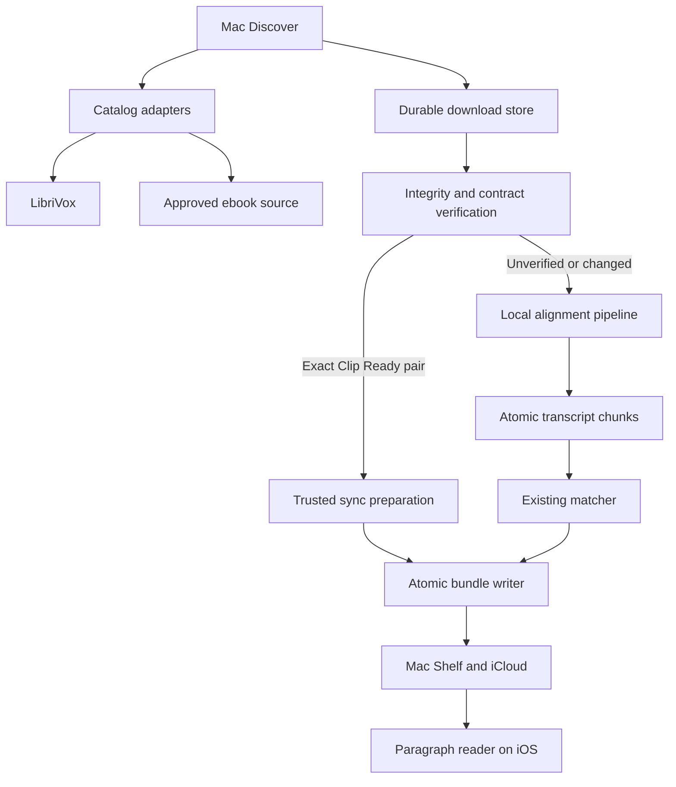
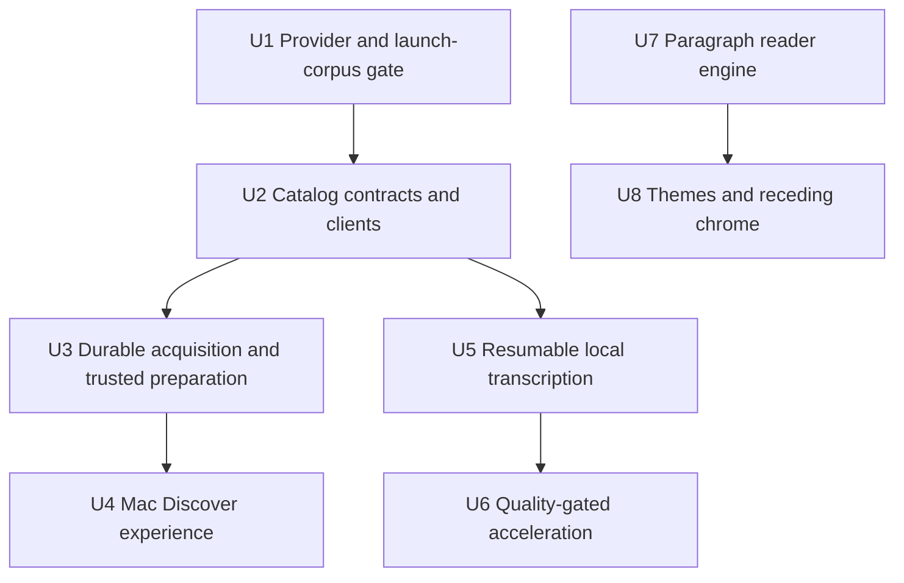
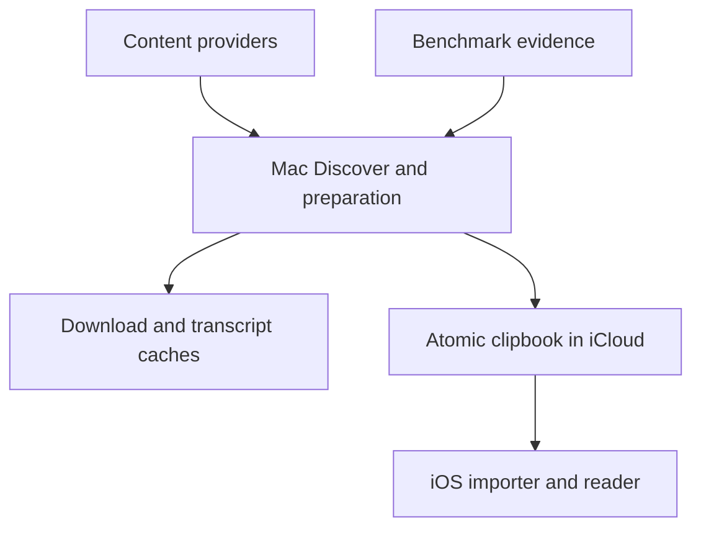

# feat: Add book discovery, safe preparation, and a calmer reader

## Overview

Add a Mac-first Discover experience with a curated Clip Ready shelf, broader LibriVox search, and browser-based guidance for contemporary DRM-free sources. Verified books bypass transcription only after every source file and the alignment artifact pass exact integrity checks; all other books feed the existing local pipeline. In parallel, make local transcription resumable and benchmark any acceleration against explicit quality gates, then replace the iOS transcript-like sentence stack with a continuous, themed, paragraph-based reading surface.

The work should land in separable phases. Reader polish does not depend on catalog integration, and resumable transcription does not depend on finding a faster model. The public catalog may ship only after provider usage and download terms are confirmed.

---

## Problem Frame

Today Clip begins after a reader has already found and downloaded a compatible EPUB/audiobook pair. That is the largest first-run obstacle. Local preparation is also expensive and currently caches only an entire completed transcription, so interruption can discard hours of work. The iOS reader preserves sentence timing well but visually breaks prose into transcript-like rows and gives persistent player controls too much weight.

The origin requirements choose a hybrid catalog, one-step preparation for exact verified pairs, fail-closed alignment reuse, quality-gated speed work, continuous rather than paginated reading, and white/warm/dark themes (see origin: `docs/brainstorms/2026-09-02-discovery-alignment-reader-requirements.md`).

---

## Requirements Trace

- R1, R2. Add Discover on Mac with Clip Ready, full public-domain search, and contemporary-source guidance; show recording and compatibility metadata before download.
- R3. Make **Get & Prepare** a resumable one-step path from a verified catalog entry to a finished Shelf book.
- R4, R5, R6. Keep full public-domain search honest about local work, preserve partial acquisitions when an EPUB is unavailable, and honor provider attribution, access limits, and country caveats.
- R7. Reuse trusted alignment only after exact source and artifact verification; otherwise fail closed to local preparation.
- R8. Persist local transcription in bounded, reusable units and retain compatibility with the existing whole-book cache.
- R9, R10. Establish a representative baseline and promote no faster path unless it passes every coverage, validation, and drift gate; fall back at bounded-unit granularity.
- R11. Report durable stage progress and measured estimates, including cache use and fallback.
- R12, R13. Render coherent paragraphs while preserving sentence-level seek, follow, selection, and clipping, with distinct restrained active and selected treatments.
- R14, R15. Add white, warm paper, and dark reader themes plus global text size, spacing, and margin preferences with a complete reset.
- R16. Let reader chrome recede without making play/pause, return-to-spoken-passage, or Clip difficult to reach.

**Origin actors:** A1 (reader/listener), A2 (Clip across Mac and iPhone), A3 (public-domain or external content provider)

**Origin flows:** F1 (Get a Clip Ready book), F2 (Get an unverified public-domain book), F3 (Bring a contemporary book), F4 (Read continuously on iPhone)

**Origin acceptance examples:** AE1 (verified preparation without transcription), AE2 (changed upstream file fails closed), AE3 (missing EPUB preserves acquired work), AE4 (interrupted preparation resumes), AE5 (stable paragraphs preserve audio following), AE6 (reader preferences persist and reset)

---

## Scope Boundaries

- Do not sell books, process purchases, connect retailer/library accounts, remove DRM, or accept protected formats.
- Do not proxy, host, or redistribute third-party ebook or audiobook files. Source downloads must go directly from an approved provider to the reader's Mac.
- Keep contemporary-book acquisition to a compatibility guide and browser links; do not build a commercial catalog.
- Do not add pagination, page-turn animation, or a second reading mode.
- Do not add a general-purpose OPDS client, community alignment uploads, social features, ratings, arbitrary reader colors/fonts, or per-book appearance settings.
- Keep Discover and preparation on Mac. iOS catalog browsing remains follow-up work.
- Preserve the `.clipbook` schema and iOS import/playback contracts unless implementation reveals a validated compatibility defect that cannot be fixed at the producer boundary.
- Preserve existing user work in `ClipMac/ViewModels/ClipMacModel.swift`, `project.yml`, Mac screenshot fixtures, and other dirty worktree files; extend overlapping files rather than replacing those edits.

### Deferred to Follow-Up Work

- Remote, independently updateable Clip Ready catalog: the first release uses a catalog bundled inside the code-signed Mac app. Remote catalog updates require a signed-manifest design and key-rotation procedure in a later plan.
- iOS discovery and remote preparation: revisit only after the Mac funnel and source contracts prove reliable.

---

## Context & Research

### Relevant Code and Patterns

- `ClipMac/UI/RootView.swift` and `ClipMac/ViewModels/ClipMacModel.swift` own the current Align/Shelf navigation and serial job queue. Discover should become a sibling section without destabilizing manual import.
- `ClipMac/Services/FileIngestionService.swift` and `ClipMac/UI/DropPairingView.swift` are the escape hatch for user-owned files and the handoff point when catalog acquisition lacks an EPUB.
- `ClipMac/Services/AlignmentPipeline.swift` already separates preparing, listening, matching, and writing; catalog and resumable paths should emit the same user-facing stage vocabulary.
- `ClipMac/Services/WhisperTranscriber.swift` deliberately holds WhisperKit concurrency at one after Neural Engine and high-concurrency failures on M1 hardware. That safety setting remains the baseline until benchmark evidence says otherwise.
- `ClipMac/Services/TranscriptCache.swift` streams SHA-256 over complete audio sets and atomically writes completed whole-book transcripts. Extract its digest pattern and preserve the v1 cache as a fast compatibility path.
- `ClipCore/Sources/ClipCore/BundleWriter.swift` performs validation and atomic package replacement, but currently sorts incoming audio independently of `sync.audio`. Trusted preparation must make source-to-manifest ordering explicit and path-safe.
- `ClipCore/Sources/ClipCore/EPUBReader.swift` demonstrates bounded archive parsing and `XMLParser` usage that can inform defensive provider parsing.
- `Clip/UI/ReaderView.swift` owns audio following, tap-to-seek, drag selection, display controls, and the persistent footer. Preserve these behaviors while replacing its visual text layout.
- `Clip/Data/Database.swift` already retains paragraph ordinal `p`, chapter, sentence index, and timings, which is sufficient to build stable paragraph and sentence-range maps without a migration.
- `Clip/Support/ClipUITestFixture.swift`, `ClipUITests/PlayerLayoutUITests.swift`, `ClipMac/Support/ClipMacUITestFixture.swift`, and `ClipMacUITests/AppStoreScreenshotUITests.swift` provide deterministic UI seams that should be extended instead of introducing network-dependent UI tests.

### Institutional Learnings

- No `docs/solutions/` corpus exists in this repository. `SESSION_HANDOFF.md` is the relevant operational record: it documents Neural Engine failures, misleading VAD progress, the danger of Debug performance testing, and the requirement to benchmark short Release probes before full books.
- Git history shows the persistent reader footer was introduced to keep clipping actions reachable on compact phones. The redesign must reduce visual weight without regressing that reachability.

### External References

- [LibriVox API](https://librivox.org/api/info): official released catalog endpoint with audiobook, track, duration, cover, and source-text fields.
- [LibriVox public-domain policy](https://librivox.org/pages/public-domain/): recordings are public domain in the United States, with country-specific caveats.
- [Project Gutenberg offline catalogs and feeds](https://www.gutenberg.org/ebooks/offline_catalogs.html): OPDS is intended for application discovery, but the current XML feed is expected to sunset in 2027 and OPDS 2 access requires coordination.
- [Project Gutenberg terms](https://www.gutenberg.org/policy/terms_of_use.html): clients must identify themselves, request one page at a time, avoid high-volume/deep-link behavior, and present country-specific caveats.
- [Apple URLSession download tasks](https://developer.apple.com/documentation/foundation/urlsessiondownloadtask): download tasks write to temporary files, report progress, and can resume when server capabilities permit.
- [Apple CryptoKit SHA-256](https://developer.apple.com/documentation/cryptokit/sha256): supports incremental hashing for files too large to load into memory.
- [Apple TextKit](https://developer.apple.com/documentation/uikit/textkit): provides attributed text layout, range selection, and position-to-character mapping needed for an interactive paragraph renderer on iOS 17.
- [WhisperKit decoding options](https://github.com/argmaxinc/whisperkit/blob/main/Sources/WhisperKit/Core/Configurations.swift): concurrency and chunking are explicit decoding inputs and therefore belong in the cache identity and benchmark matrix.

---

## Key Technical Decisions

| Decision | Choice | Rationale |
|---|---|---|
| Provider boundary | Provider-neutral domain models with separate LibriVox and approved ebook-source adapters | Prevents Project Gutenberg's 2027 feed transition from infecting UI and preparation logic. |
| Curated trust root | Bundle the v1 Clip Ready index in the code-signed app and pin SHA-256 for every source file and remote alignment artifact | Avoids a remote mutable manifest or embedded signing-key lifecycle in the first release. |
| Alignment artifact | Publish a size-capped, versioned sync JSON document rather than an archive or executable format | Keeps the trusted payload narrow, inspectable, and subject to the existing sync validator and safe filename rules. |
| File delivery | Download source files directly from approved HTTPS provider hosts with a resumable `URLSession`-backed store | Honors the no-hosting boundary and keeps durable progress independent of SwiftUI view lifetime. |
| Trusted preparation | Verify index, artifact, EPUB, every ordered audio file, decoded sync validity, safe paths, and measured duration consistency before packaging | Exact identity—not title/author—is the only reason transcription may be skipped. |
| Local resume unit | Cache sequential 10–20 minute source ranges, preferring embedded audio chapter boundaries and using deterministic overlap reconciliation when a long range must split | Limits lost work while avoiding unbounded parallel pressure on the shared model/GPU. |
| Acceleration rollout | Instrument first; evaluate one model/compute/concurrency variable at a time in optimized builds; promote only a candidate passing all origin quality gates | A failed experiment may produce no default speed change, but cannot silently reduce alignment quality. |
| Reader renderer | Build a stable paragraph/sentence range document and render it through a non-editable TextKit-backed view wrapped for SwiftUI | SwiftUI on the iOS 17 deployment target does not expose enough subrange layout/selection mapping to preserve current interactions inside a single flowing paragraph. |
| Reader updates | Build attributed content once, then change temporary attributes and scroll targets for the active/selected ranges | Prevents reflow and full-book reconstruction on every playback tick. |

---

## Open Questions

### Resolved During Planning

- **How should the first Clip Ready catalog be authenticated?** Bundle the catalog index in the code-signed Mac app; host only derived alignment artifacts at a controlled static endpoint and pin each artifact digest in the bundled index.
- **How large should the initial curated shelf be?** Target 12 English, solo-narrated, non-collection titles spanning short and long books. Each must have stable direct source files, an approved EPUB acquisition route, at least 95% validated coverage, and sampled seek drift within two seconds.
- **Should current Project Gutenberg XML OPDS become a durable dependency?** No. Use it only for contract fixtures/spike work while obtaining OPDS 2 access or an approved mirror arrangement; do not ship a provider path known to be near retirement without a migration commitment.
- **What happens when provider automation is unavailable?** Clip Ready cannot claim one-step preparation for that entry. The v1 bundled index requires an app update to remove its label; as an emergency brake, removing the hosted artifact disables trusted bypass and produces an explicit local-preparation fallback. Full search may retain a browser/user-supplied EPUB handoff with downloaded audio preserved.
- **How should local work resume?** Persist atomic transcript fragments keyed by exact audio digest, model variant, decoding configuration version, and source time/sample range, then merge only validated completed fragments.
- **How should the reader achieve flowing paragraphs on iOS 17?** Use a TextKit-backed interaction surface with a pure range-mapping model, leaving SwiftUI responsible for surrounding chrome, preferences, and playback actions.

### Deferred to Implementation

- **Exact approved ebook provider and endpoint:** U1 must record the provider response/permission and stable acquisition contract before production download URLs are enabled.
- **Exact chunk length and overlap:** Measure 10-, 15-, and 20-minute candidates on the baseline corpus; choose the shortest range that does not materially increase boundary errors or overhead.
- **Acceleration candidate:** Evaluate smaller supported WhisperKit variants and bounded worker counts separately. If none pass R9, ship only Clip Ready bypass, resumability, and truthful progress.
- **Reader chrome timing and animation constants:** Tune using compact-phone, large-phone, and iPad screenshots after interaction parity passes; Reduce Motion uses immediate or cross-fade changes.
- **Final contemporary-source link list:** Verify each provider's current DRM-free/export language before release and keep copy explicit that matching editions are the reader's responsibility.

---

## Output Structure

    ClipMac/
      Models/
        DiscoveryModels.swift
        ClipReadyCatalog.swift
      Services/
        ContentIntegrityService.swift
        LibriVoxCatalogService.swift
        EbookCatalogService.swift
        DiscoveryDownloadStore.swift
        ClipReadyPreparationService.swift
        TranscriptionChunkStore.swift
      UI/
        DiscoverView.swift
        DiscoveryBookView.swift
      ViewModels/
        DiscoverViewModel.swift
    Clip/
      Support/
        ReaderPreferences.swift
      UI/Reader/
        ReaderDocument.swift
        ReaderTextView.swift
        ReaderAppearance.swift
        ReaderControls.swift
    ClipMacTests/
      Fixtures/
      DiscoveryCatalogTests.swift
      DiscoveryDownloadStoreTests.swift
      ClipReadyPreparationTests.swift
      TranscriptionChunkStoreTests.swift
      AlignmentBenchmarkTests.swift
    ClipTests/
      ReaderDocumentTests.swift
      ReaderPreferencesTests.swift
    Resources/
      Catalog/
        clip-ready-v1.json
        README.md

This tree is directional. Existing files listed in the implementation units remain the authoritative integration points.

---

## High-Level Technical Design

> *This illustrates the intended approach and is directional guidance for review, not implementation specification. The implementing agent should treat it as context, not code to reproduce.*

Catalog availability and download state are not part of `.clipbook`; only a completed validated package crosses to iOS. The existing matcher and iOS importer remain the compatibility boundaries for locally prepared books.

---

## Implementation Units

The prose dependency fields below are authoritative.

- [ ] U1. **Confirm provider contracts and establish the launch corpus**

**Goal:** Remove the legal/operational uncertainty from automated ebook acquisition and define reproducible evidence for the first 12 Clip Ready titles and the alignment benchmark corpus.

**Requirements:** R2, R4, R6, R9; A3; F1, F2, F3

**Dependencies:** None

**Files:**
- Create: `docs/research/public-domain-provider-contract.md`
- Create: `docs/research/alignment-benchmark-corpus.md`
- Create: `Resources/Catalog/clip-ready-v1.json`
- Create: `Resources/Catalog/README.md`

**Approach:**
- Record LibriVox request fields, attribution, pagination, track-order semantics, redirect hosts, and rate expectations using official documentation and representative fixtures.
- Obtain and document an approved machine-readable EPUB discovery/download route. Prefer Project Gutenberg OPDS 2 or a provider-approved mirror; do not treat page scraping or large-scale deep links as an acceptable fallback.
- Select 12 launch titles using the resolved criteria: English, solo narration, not a collection/drama, stable EPUB plus ordered audio files, useful duration variety, coverage at least 95%, and sampled drift within two seconds.
- Produce each title's alignment artifact from the existing reliable local path, validate it against the exact ordered source files, publish the size-capped JSON to the controlled artifact host, and record its source/artifact digests plus validation report before enabling the catalog entry.
- Define a separate representative benchmark corpus covering multi-file MP3, single-file M4B, long chapters, reader accents, narrator boilerplate, imperfect editions, and at least one expected mismatch. Public-domain source pointers and digests belong in the document; large media does not belong in git.
- Keep the bundled catalog disabled for production display until its provider contract and every entry's evidence are complete.

**Execution note:** This is a go/no-go gate. Do not implement a production deep-link workaround if provider approval is unavailable.

**Patterns to follow:**
- `AppStore/review-notes.md` for explicit third-party-content disclosure.
- `README.md` and `docs/support/index.html` for plain-language DRM and ownership boundaries.

**Test scenarios:**
- Test expectation: none — this unit produces reviewed provider and corpus artifacts rather than runtime behavior.

**Verification:**
- Every enabled Clip Ready entry has stable provider URLs, ordered source digests, artifact digest, attribution/country copy, and recorded coverage/drift evidence.
- The ebook provider route is explicitly approved for app use and has a documented migration path beyond the current XML OPDS feed.

- [ ] U2. **Add catalog contracts and defensive provider clients**

**Goal:** Fetch and normalize Clip Ready entries and paged LibriVox/ebook results behind testable, provider-neutral interfaces without coupling views to raw external responses.

**Requirements:** R1, R2, R4, R5, R6; F1, F2, F3

**Dependencies:** U1 for production endpoint enablement; fixture-driven implementation may begin while the external gate is pending.

**Files:**
- Create: `ClipMac/Models/DiscoveryModels.swift`
- Create: `ClipMac/Models/ClipReadyCatalog.swift`
- Create: `ClipMac/Services/LibriVoxCatalogService.swift`
- Create: `ClipMac/Services/EbookCatalogService.swift`
- Create: `ClipMac/Services/ContentIntegrityService.swift`
- Create: `ClipMacTests/DiscoveryCatalogTests.swift`
- Create: `ClipMacTests/ContentIntegrityServiceTests.swift`
- Create: `ClipMacTests/Fixtures/librivox-search.json`
- Create: `ClipMacTests/Fixtures/ebook-search.opds`
- Modify: `ClipCore/Sources/ClipCore/SharedContracts.swift`
- Modify: `ClipCore/Tests/ClipCoreTests/SharedContractsTests.swift`
- Modify: `project.yml`

**Approach:**
- Introduce a Mac unit-test target while preserving the user's existing Mac UI-test additions in `project.yml`.
- Add `Resources/Catalog` to the Mac app's resources only; do not increase the iOS bundle or expose an unused iOS catalog surface.
- Decode provider DTOs into one domain shape containing stable ID, title/author, reader attribution, language, duration, cover, ordered audio references, source-text reference, approximate bytes when known, and preparation classification.
- Load Clip Ready from the bundled code-signed catalog and merge its status into live search by stable provider/source IDs—not fuzzy title matching.
- Extract the existing streaming SHA-256 pattern into one content-integrity service shared by trusted downloads and transcript-cache identities; keep all large-file hashing incremental.
- Use dependency-injected sessions and one-page-at-a-time pagination. Debounce searches, cache recent responses briefly, set the required identifying user agent, and surface retry/rate-limit states without automatic page storms.
- Reject non-HTTPS download URLs, unexpected redirect hosts, oversized response bodies, malformed counts/durations, unsafe filenames, and unsupported audio/ebook types before they reach the download store.
- Treat remote covers as optional untrusted input: fetch only from approved HTTPS hosts through a size-capped cache and fall back to a local placeholder on any redirect, decode, or size failure.

**Execution note:** Implement provider decoding and URL policy test-first from captured fixtures; never make unit tests depend on the live network.

**Patterns to follow:**
- `ClipCore/Sources/ClipCore/ReadwiseClient.swift` for injected `URLSession` and status classification.
- `ClipCore/Sources/ClipCore/EPUBReader.swift` for defensive XML parsing and bounded input validation.

**Test scenarios:**
- Happy path: a LibriVox solo title with multiple tracks maps to one ordered discovery result with narrator, duration, cover, language, and source-text reference.
- Happy path: a bundled entry with matching provider IDs is labeled Clip Ready; a title-only lookalike is not.
- Edge case: missing cover, unknown size, empty author, and multiple readers remain displayable with explicit fallback labels.
- Edge case: search requests fetch one page initially and fetch the next only after an explicit continuation request.
- Error path: malformed JSON/XML, HTTP 429/5xx, an oversized response, or an unsupported format produces a recoverable catalog error.
- Error path: HTTP URLs, unexpected redirects, traversal filenames, or unapproved hosts are rejected before download.
- Integration: the identifying user agent and provider-required query limits are present in every request.
- Integration: EPUB, audio, and alignment-artifact fixtures produce stable streaming digests without loading whole files into memory.

**Verification:**
- Fixture-based Mac tests prove stable normalization, Clip Ready classification, provider-policy enforcement, and recoverable errors without live requests.

- [ ] U3. **Build durable acquisition and exact trusted preparation**

**Goal:** Turn catalog choices into resumable local files, fail-closed verification, and either a transcription-free validated `.clipbook` or a preserved handoff to local alignment.

**Requirements:** R3, R4, R5, R6, R7, R11; F1, F2; AE1, AE2, AE3

**Dependencies:** U2; U1 before enabling real provider URLs

**Files:**
- Create: `ClipMac/Services/DiscoveryDownloadStore.swift`
- Create: `ClipMac/Services/ClipReadyPreparationService.swift`
- Create: `ClipMacTests/DiscoveryDownloadStoreTests.swift`
- Create: `ClipMacTests/ClipReadyPreparationTests.swift`
- Modify: `ClipMac/ViewModels/ClipMacModel.swift`
- Modify: `ClipCore/Sources/ClipCore/BundleWriter.swift`
- Modify: `ClipCore/Tests/ClipCoreTests/BundleWriterTests.swift`

**Approach:**
- Persist one download-job manifest per catalog acquisition under Application Support, including provider IDs, expected ordered files, completed file locations/digests, active task identifiers or resume data, stage, and recoverable error. Write state atomically and reconcile it on launch.
- Keep the durable job state machine separate from its background-session delegate adapter. Exercise state transitions with an injected deterministic transfer double, then use a local HTTP range fixture for the smaller set of actual pause/resume and restoration checks.
- Download each provider file to a job-scoped staging directory through a stably identified background session, bounded concurrency, explicit size caps, progress aggregation, and pause/cancel with resume data where supported. On launch or delegate restoration, enumerate active tasks and reconcile them with persisted jobs; if resume data or server range support is unavailable, restart only the incomplete file.
- Reuse the shared incremental content-integrity service so large EPUB/audio/artifact files are verified without loading them into memory.
- For Clip Ready, verify the bundled entry, remote alignment artifact digest, EPUB digest, every audio digest and order, safe artifact paths, `ClipBookSync.validate()`, and measured audio-duration consistency. Only then call the atomic bundle writer and mark the Shelf item complete.
- Update `BundleWriter` so audio input order maps explicitly to validated `sync.audio` destinations instead of being re-sorted independently. Reject absolute/traversal paths, count/name mismatches, duplicate destinations, and unsupported destinations.
- Give catalog-prepared bundles a deterministic edition-aware destination name (title plus narrator/provider identity). Replace an existing destination only when it represents the same catalog edition; otherwise disambiguate it so a same-title recording or user-created book is never overwritten.
- If any trusted check fails, retain valid downloads, record why Clip Ready was declined, and construct the existing pairing/local-alignment input. If the EPUB is absent, retain audio and metadata while requesting an EPUB.
- If the hosted artifact is unavailable or withdrawn, present the entry as no longer instant for this attempt and offer the same explicit local-preparation fallback; never treat a server failure as trusted success.
- On successful packaging, clean only job-scoped transient state. On cancel, preserve resumable state; offer a distinct remove action for destructive cleanup.

**Execution note:** Start with failing integrity, path-safety, interruption, and hash-mismatch tests. Do not exercise Whisper in these tests.

**Patterns to follow:**
- `ClipMac/Services/TranscriptCache.swift` for streaming digest and atomic persistence.
- `ClipCore/Sources/ClipCore/BundleWriter.swift` and `Clip/Data/BundleImporter.swift` for staging, validation, and atomic replacement.
- `ClipMac/ViewModels/ClipMacModel.swift` for serial local jobs and manual-pairing fallback.

**Test scenarios:**
- Covers F1 / AE1. Exact EPUB, ordered audio, and artifact digests produce a valid finished bundle without invoking the transcriber.
- Covers AE2. One changed audio byte or wrong artifact digest prevents trusted packaging and hands the intact files to local preparation.
- Covers AE3. Audio completes while no compatible EPUB exists; supplying an EPUB later reuses the audio and catalog metadata without redownload.
- Happy path: a paused resumable server download continues from stored resume data and aggregates progress from the resumed offset.
- Edge case: a server without range support restarts only the incomplete file and retains already verified files.
- Edge case: reopening after an atomic state write reconstructs the job; corrupt state is quarantined without touching unrelated files.
- Error path: an artifact that is withdrawn or returns a server error never enters trusted packaging and clearly falls back to local preparation with completed source downloads intact.
- Error path: insufficient disk, bad HTTP status, size-cap violation, unsafe sync path, duplicate filename, duration mismatch, or malformed sync produces a specific recoverable failure and no partial `.clipbook`.
- Error path: preparing a second recording with the same title creates a distinct Shelf package, while repeating the same catalog job updates idempotently and never overwrites an unrelated user-created package.
- Integration: a completed package appears through the existing Shelf refresh and remains importable by the current iOS bundle importer.

**Verification:**
- A deterministic fixture exercises verified bypass and fail-closed fallback end to end, and no failure path leaves a visible partial package in the destination.

- [ ] U4. **Add the Mac Discover and source-guidance experience**

**Goal:** Expose the hybrid catalog and preparation lifecycle through a warm, legible Mac flow that makes the safest path the easiest path.

**Requirements:** R1, R2, R3, R4, R5, R6, R11; A1, A2, A3; F1, F2, F3

**Dependencies:** U2-U3

**Files:**
- Create: `ClipMac/ViewModels/DiscoverViewModel.swift`
- Create: `ClipMac/UI/DiscoverView.swift`
- Create: `ClipMac/UI/DiscoveryBookView.swift`
- Create: `ClipMac/Resources/ContemporarySources.json`
- Modify: `ClipMac/UI/RootView.swift`
- Modify: `ClipMac/UI/DropPairingView.swift`
- Modify: `ClipMac/Models/MacModels.swift`
- Modify: `ClipMac/ClipMacApp.swift`
- Modify: `ClipMac/Support/ClipMacUITestFixture.swift`
- Modify: `ClipMacUITests/AppStoreScreenshotUITests.swift`

**Approach:**
- Add Discover as the first Mac section, retain Align for owned files, and keep Shelf as the destination. First-run onboarding offers **Find a free book** and **Use my files** without adding account setup.
- Lead with a compact 12-title Clip Ready shelf. Put full public-domain search below/behind a clear secondary action and mark every result as Clip Ready, local preparation, or needs EPUB.
- Show title, author, reader attribution, language, duration, size when known, source, country caveat, and preparation expectation before the primary action.
- Bind download/preparation cards to persisted store state rather than view-local tasks. Make pause/cancel, retry, remove, fallback, and **On Shelf** states explicit.
- Build the contemporary guide as bundled reviewed content with browser links and format checks. Mention DRM-free EPUB plus MP3/M4A/M4B and warn that the ebook must match the narrated edition.
- Preserve keyboard/file-picker paths and existing accessibility identifiers; add deterministic offline catalog/download fixtures for UI tests.

**Patterns to follow:**
- `ClipMac/UI/DropPairingView.swift` for cards, file status, and plain-language feedback.
- `ClipMac/UI/AlignmentJobView.swift` for progress and recovery states.
- `ClipMac/UI/ShelfView.swift` for cover grids.

**Test scenarios:**
- Covers F1. From a fresh launch, a reader can enter Discover, inspect a Clip Ready title, choose Get & Prepare, observe deterministic progress, and reach On Shelf.
- Covers F2. An unverified result states that local preparation is required before any large download begins.
- Covers F3. The contemporary guide opens an approved HTTPS source in the system browser and never asks for retailer credentials.
- Edge case: an empty/failed search retains the featured shelf and offers a useful retry rather than replacing the whole screen with an error.
- Edge case: an already completed or resumable title shows Open/Resume rather than starting a duplicate job.
- Accessibility: result cards expose title, author, reader, duration, compatibility status, and action in a sensible order; keyboard focus can reach search, results, and job controls.
- Integration: switching among Discover, Align, and Shelf does not cancel persisted downloads or serial alignment jobs.

**Verification:**
- Mac UI tests cover the featured, full-search, missing-EPUB, progress, and On Shelf states without network access, and updated screenshots fit the existing Marginalia visual system.

- [ ] U5. **Make local transcription resumable with truthful progress**

**Goal:** Bound the work lost to interruption, reuse completed listening ranges, and report progress from durable units while preserving the known-reliable serial compute path.

**Requirements:** R8, R10, R11; F2; AE4

**Dependencies:** U2 for shared digest contracts; may be developed in parallel with U3-U4

**Files:**
- Create: `ClipMac/Models/TranscriptionChunk.swift`
- Create: `ClipMac/Services/TranscriptionChunkStore.swift`
- Create: `ClipMacTests/TranscriptionChunkStoreTests.swift`
- Modify: `ClipMac/Services/AudioMetadataService.swift`
- Modify: `ClipMac/Services/TranscriptCache.swift`
- Modify: `ClipMac/Services/WhisperTranscriber.swift`
- Modify: `ClipMac/Services/AlignmentPipeline.swift`
- Modify: `ClipMac/Models/MacModels.swift`
- Modify: `ClipMac/UI/AlignmentJobView.swift`
- Modify: `ClipMac/ViewModels/ClipMacModel.swift`
- Modify: `ClipCore/Sources/ClipCore/SharedContracts.swift`
- Modify: `ClipCore/Tests/ClipCoreTests/SharedContractsTests.swift`

**Approach:**
- Characterize and retain current whole-audio cache reads. When no complete cache exists, derive deterministic source ranges from ordered audio-file boundaries and embedded chapter time ranges, subdividing long ranges only at measured safe boundaries.
- Identify every fragment by source digest, model variant, decoding/compute configuration version, exact sample/time range, overlap policy, and cache schema version. Write each successful fragment atomically before proceeding.
- Keep model use sequential and `concurrentWorkerCount` at one. Load only the bounded audio range needed for the current fragment, convert word timestamps to global source time, reconcile overlapping boundary words deterministically, and validate monotonicity before admitting a fragment.
- Aggregate cached and newly completed ranges into the existing `[MacTranscriptWord]` contract so `Matcher.align` and `.clipbook` output remain unchanged.
- Report durable completed audio time plus current-range progress. Derive estimates from observed throughput per model/device during the current run, not the optimistic static realtime factors alone.
- When a fragment is corrupt or its identity changes, recompute only that fragment; never merge fragments produced by incompatible model/configuration identities.
- Put completed inactive fragments under a documented cache budget with least-recently-used eviction. Never evict fragments owned by an active job, and provide per-book cleanup without deleting a valid legacy whole-book cache unexpectedly.

**Execution note:** Characterization-first. Prove whole-cache compatibility, range-boundary reconciliation, and crash/relaunch behavior before changing the production transcriber loop.

**Patterns to follow:**
- `ClipMac/Services/TranscriptCache.swift` for atomic JSON cache entries.
- `ClipCore/Sources/ClipCore/Matcher.swift` for stable chronological ordering and timing validation.
- WhisperKit's ranged audio loading and explicit decoding options at the repository's pinned 0.18.0 dependency, not current-main-only APIs.

**Test scenarios:**
- Covers AE4. A simulated interruption after several fragments leaves those fragments readable; the next run requests only incomplete ranges and produces the same aggregate transcript as an uninterrupted run.
- Happy path: a valid legacy whole-book cache bypasses chunk planning and remains immediately reusable.
- Happy path: a single-file M4B with usable chapters and a multi-file MP3 book both produce deterministic bounded plans and monotonic global timestamps.
- Edge case: a long chapter is subdivided; duplicate boundary words collapse without removing legitimately repeated adjacent words.
- Edge case: mixed cached/new fragments report monotonic durable progress and an estimate based on observed throughput.
- Error path: truncated JSON, mismatched model/configuration version, changed audio digest, or invalid timestamp range invalidates only the affected fragment.
- Error path: exceeding the cache budget evicts only least-recently-used inactive fragments; an active interrupted job remains resumable.
- Integration: the merged transcript passes the existing matcher and sync validator with output equivalent to the pre-chunk path on deterministic fixture audio.

**Verification:**
- Killing and relaunching a Release fixture run after at least two completed fragments resumes without retranscribing them, while existing whole-cache re-alignment stays fast.

- [ ] U6. **Benchmark and gate any alignment acceleration**

**Goal:** Produce evidence for a faster default or explicitly retain the current default when no candidate is safe, without turning exploratory tuning into production behavior.

**Requirements:** R9, R10, R11; AE4

**Dependencies:** U1 benchmark corpus, U5 resumable pipeline

**Files:**
- Create: `ClipMacTests/AlignmentBenchmarkTests.swift`
- Create: `ClipMacTests/Fixtures/alignment-benchmark-manifest.json`
- Create: `docs/research/alignment-performance-baseline.md`
- Modify: `ClipMac/Models/MacModels.swift`
- Modify: `ClipMac/Services/WhisperTranscriber.swift`
- Modify: `ClipMac/Services/AlignmentPipeline.swift`
- Modify: `ClipMac/UI/QualitySettingsView.swift`
- Modify: `ClipCore/Sources/ClipCore/Matcher.swift`
- Modify: `ClipCore/Tests/ClipCoreTests/MatcherTests.swift`

**Approach:**
- Add an opt-in Release benchmark harness that consumes the documented local/public-domain corpus, records model/configuration, device, stage timings, peak memory where available, coverage, validation result, and sampled seek drift, and never downloads a model during ordinary tests.
- Record the existing Standard path as the immutable comparison baseline before testing candidates.
- Use the stage timings to distinguish listening from text matching. If matching is material, profile the existing matcher and test algorithmic/indexing changes behind exact-output equivalence fixtures before considering broader quality-gated changes.
- Evaluate variables separately: supported smaller/turbo model, compute placement, bounded range length, then bounded worker count. Do not combine changes until each isolated result is understood.
- Apply the R9 gates per candidate: zero sync validation failures, median coverage not lower than baseline, no individual coverage drop over one percentage point, and sampled p95 drift at or below two seconds. Also reject candidates with unstable memory or thermal behavior even if wall time improves.
- If a candidate passes, make it eligible for Standard with automatic per-fragment fallback to the reliable model when confidence or validation is insufficient. Keep Maximum explicit. Rename or hide Fast test from normal users unless it has a supported product role.
- If no candidate passes, make no default model/concurrency change. Ship the measurable wins from Clip Ready bypass, resumability, and cache reuse, and record the rejected evidence.

**Execution note:** One controlled change at a time; short excerpts first, then full public-domain books in optimized builds. Never use Debug timings to promote a candidate.

**Patterns to follow:**
- `SESSION_HANDOFF.md` for Release-only performance evidence and M1 compute constraints.
- `ClipCore/Tests/ClipCoreTests/MatcherTests.swift` and `SyncModelsTests.swift` for coverage and validity assertions.

**Test scenarios:**
- Happy path: the harness emits comparable stage and quality records for baseline and one candidate on the same source digests.
- Edge case: missing corpus or model produces an explicit skipped benchmark, not a passing result or implicit download.
- Error path: any validation failure, excessive per-book regression, drift failure, or incomplete result marks the candidate ineligible regardless of speed.
- Integration: a matcher-only optimization produces the same sentence/audio assignments and coverage report as the baseline across the corpus; any semantic difference routes it through the full quality gates or rejects it.
- Integration: an eligible accelerated fragment that fails its runtime confidence check is recomputed by the reliable path and yields a valid aggregate transcript without discarding other fragments.

**Verification:**
- `docs/research/alignment-performance-baseline.md` contains reproducible results and a clear promote/reject decision. Production defaults change only when the recorded matrix passes every gate.

- [ ] U7. **Introduce a stable paragraph reader engine**

**Goal:** Render prose as continuous paragraphs while preserving sentence-level playback, follow, selection, clipping, and accessibility semantics on iOS 17.

**Requirements:** R12, R13; F4; AE5

**Dependencies:** None; may proceed in parallel with U1-U6

**Files:**
- Create: `Clip/UI/Reader/ReaderDocument.swift`
- Create: `Clip/UI/Reader/ReaderTextView.swift`
- Create: `ClipTests/ReaderDocumentTests.swift`
- Modify: `Clip/UI/ReaderView.swift`
- Modify: `Clip/Support/ClipUITestFixture.swift`
- Modify: `ClipUITests/PlayerLayoutUITests.swift`

**Approach:**
- Build a pure reader document from ordered `SentenceRecord` values. Preserve chapter boundaries and paragraph ordinal, insert normalized inter-sentence whitespace, and maintain bidirectional maps between sentence IDs and character ranges.
- Wrap a non-editable, attributed TextKit view for SwiftUI. Keep one stable text document, map taps/selection points back to sentence ranges, and expose callbacks for seek, manual scroll, selected sentence range, and visible active range.
- Make the TextKit view the reader's sole scrolling surface rather than nesting it inside the existing SwiftUI scroll view. Resolve single taps as seek only when they do not conflict with native long-press/range selection.
- Update only temporary foreground/background attributes when the active or selected range changes; do not rebuild the document or alter paragraph geometry on playback ticks.
- Scroll the active range toward a calm reading anchor only while following. User scrolling disables follow; Return to spoken passage restores it.
- Preserve the current selection-to-Clip behavior using range mapping and ensure selected and active states can overlap without becoming indistinguishable.
- Expand the fixture to include several sentences in one paragraph, multiple paragraphs, an untimed sentence, and two chapters so screenshot/UI tests can detect transcript-row regressions.

**Execution note:** Build the range-mapping model test-first, then add the TextKit adapter behind the existing `ReaderView` shell so interaction regressions are isolated.

**Patterns to follow:**
- `Clip/UI/ReaderView.swift` for active sentence search and follow state.
- `Clip/Data/Database.swift` for paragraph/chapter ordering.
- Apple TextKit position-to-character mapping and selection APIs for iOS 17 compatibility.

**Test scenarios:**
- Covers F4 / AE5. Multiple sentences with the same paragraph ordinal flow together with normalized spaces, and active sentence changes do not alter any document range or measured layout.
- Happy path: tapping any character inside a timed sentence seeks to that sentence start; tapping an untimed sentence does nothing and reports the correct accessibility hint.
- Happy path: a long-press drag crossing sentence boundaries resolves to the inclusive sentence range passed to `clipSelection`.
- Edge case: empty books, one sentence, repeated text, emoji/diacritics, and composed Unicode preserve correct string/range mapping.
- Performance: a synthetic 100,000-word book builds one stable document, and repeated active-sentence updates mutate only range attributes without reconstructing text or changing layout ranges.
- Edge case: chapter changes create a heading and paragraph break without inventing or losing sentence text.
- Error path: invalid/noncontiguous input ordering is normalized or rejected deterministically rather than producing unsafe ranges.
- Accessibility: VoiceOver can read paragraph text and invoke seek/selection actions without requiring visual-only gestures.
- Integration: playback advances the restrained active range, manual scrolling exposes Return, and returning resumes follow on compact phone and iPad.

**Verification:**
- UI screenshots show at least three sentences flowing inside one paragraph, and seek/follow/selection/Clip tests remain green with stable layout during playback.

- [ ] U8. **Add reader themes, display preferences, and receding chrome**

**Goal:** Complete the Kindle-like visual polish with accessible global themes and calmer controls while retaining Clip's primary listening actions.

**Requirements:** R14, R15, R16; F4; AE6

**Dependencies:** U7

**Files:**
- Create: `Clip/Support/ReaderPreferences.swift`
- Create: `Clip/UI/Reader/ReaderAppearance.swift`
- Create: `Clip/UI/Reader/ReaderControls.swift`
- Create: `ClipTests/ReaderPreferencesTests.swift`
- Modify: `Clip/UI/ReaderView.swift`
- Modify: `Clip/UI/ClipStyle.swift`
- Modify: `ClipCore/Sources/ClipCore/DesignSystem.swift`
- Modify: `ClipUITests/PlayerLayoutUITests.swift`

**Approach:**
- Define three fixed semantic reader palettes—white, warm paper, dark—covering page, ink, secondary ink, active wash, selection, progress, and chrome. Keep general app tokens unchanged unless a reusable semantic token is truly shared.
- Centralize global reader preferences for theme, text size, line spacing, and margins with bounded validation, migration from the two existing AppStorage keys, and one complete reset.
- Replace the small menu with a focused display sheet showing immediate previews for theme and typography. Preserve Dynamic Type scaling and use readable defaults rather than exposing arbitrary fonts/colors.
- Let top/bottom chrome collapse after deliberate reading/scrolling and return on a clear tap or accessibility action. A compact resting state keeps play/pause and Clip within one interaction; Return to spoken passage remains explicit when following is off.
- Suppress large movement when Reduce Motion is enabled and keep contrast, 44-point targets, safe-area behavior, landscape/iPad width, and VoiceOver ordering in the acceptance pass.
- Refresh reader App Store screenshots only after deterministic UI tests cover all themes and compact/expanded chrome.

**Execution note:** Treat visual tuning as screenshot-driven after behavior tests pass; do not fold unrelated global design changes into this unit.

**Patterns to follow:**
- `ClipCore/Sources/ClipCore/DesignSystem.swift` for semantic design tokens and adaptive contrast.
- `Clip/UI/ClipStyle.swift` for type and control components.
- `Clip/UI/PlayerView.swift` for playback action sizing and accessibility identifiers.

**Test scenarios:**
- Covers AE6. Theme, size, spacing, and margin changes persist across different books; Reset restores every default and migrates existing size/spacing values once.
- Happy path: white, warm, and dark palettes update page, text, active, selected, progress, and chrome together without changing text ranges.
- Happy path: scrolling collapses chrome, one intentional interaction restores it, and play/pause/Clip remain within one action in either state.
- Edge case: very large text, narrow portrait, landscape, and iPad widths avoid clipped prose or inaccessible controls.
- Accessibility: each palette passes contrast review, VoiceOver order remains logical, and Reduce Motion avoids sliding/zooming chrome transitions.
- Integration: changing appearance while audio follows preserves the active sentence and scroll position.

**Verification:**
- Updated screenshots demonstrate a continuous book page in all three themes, and compact-phone UI tests prove display, play/pause, Clip, selection, and Return remain reachable.

---

## System-Wide Impact

- **Interaction graph:** `RootView` selects Discover/Align/Shelf; `DiscoverViewModel` reads catalog services and durable download state; verified preparation or local `AlignmentPipeline` writes through `BundleWriter`; Shelf/iCloud triggers the unchanged iOS importer; Reader queries the unchanged sentence database and controls the existing `PlayerEngine`/`ClipService`.
- **Error propagation:** Provider errors remain retryable Discover states; per-file download failures remain attached to the durable job; trust failures downgrade to local preparation with a reason; package validation remains terminal for that attempt; reader rendering failures should fall back to a plain noninteractive text presentation rather than crash playback.
- **State lifecycle risks:** Job manifests and fragment caches must use atomic writes, stable versioned identities, job-scoped cleanup, and reconciliation after relaunch. Duplicate taps must coalesce to one acquisition. Destination replacement must be atomic and limited to the same catalog edition; title collisions must not overwrite a different recording or user-created bundle.
- **API surface parity:** `.clipbook`, `ClipBookSync`, database rows, Siri/Live Activity, Readwise payloads, and playback APIs remain unchanged. New catalog/provider contracts are Mac-internal; reader preferences are iOS-local.
- **Integration coverage:** Fixture-driven tests must cover catalog → download → verify → bundle → Shelf and bundle → iCloud/import → paragraph reader. Live provider smoke tests are release checks, not ordinary unit-test dependencies.
- **Unchanged invariants:** Audio remains on device/iCloud; source content goes only to the chosen providers during direct download; only selected highlights go to Readwise; local alignment remains the fallback for every unverified or changed pair.

---

## Risk Analysis & Mitigation

| Risk | Likelihood | Impact | Mitigation |
|---|---|---|---|
| Provider terms or endpoints change | High | High | U1 contract gate, adapter boundary, bundled curated index, emergency artifact withdrawal to force safe fallback, app-release catalog removal, no scraping. |
| A trusted artifact is applied to changed source files | Medium | Critical | Pin and stream-verify every ordered source plus artifact; validate sync and durations; fail closed before packaging. |
| Download interruption wastes bandwidth or storage | Medium | Medium | Persist job state/resume data, verify files individually, cap sizes, expose remove separately, reconcile on launch. |
| Same-title editions overwrite each other | Medium | High | Use edition-aware catalog destinations and permit atomic replacement only for the same stable provider identity. |
| Resumable chunks create duplicate or missing boundary words | Medium | High | Deterministic overlap policy, equivalence fixtures, monotonic validation, reliable fallback per fragment. |
| Fragment caches grow without bound | Medium | Medium | Versioned cache budget, inactive-entry eviction, active-job protection, and explicit per-book cleanup. |
| A faster model looks good on easy books but breaks highlights | High | High | Representative corpus, per-book regression gates, sampled drift, one-variable experiments, no promotion on partial evidence. |
| TextKit bridge regresses VoiceOver or selection | Medium | High | Pure range model, accessibility actions, compact/iPad UI tests, manual VoiceOver acceptance before release. |
| Active highlighting rebuilds a full book each tick | Medium | Medium | Stable attributed document with temporary range attributes and measured update performance. |
| Three themes drift from the broader design system | Low | Medium | Reader-local semantic palettes, snapshot/screenshot matrix, avoid unrelated global token changes. |
| Current dirty worktree edits are overwritten | Medium | High | Inspect diffs before every overlapping edit and extend existing Mac UI-test/project configuration in place. |

---

## Phased Delivery

### Phase 1 — Independent foundations

- U1 provider/corpus gate.
- U7 paragraph reader engine.

### Phase 2 — Shared contracts and reader polish

- U2 provider-neutral catalog and content-integrity contracts.
- U8 themes, display sheet, and receding chrome.

### Phase 3 — Independent Mac pipelines

- U3 durable downloads and trusted preparation.
- U5 resumable local transcription and truthful progress.

### Phase 4 — User-facing Discover

- U4 Mac Discover, onboarding, guidance, and offline UI fixtures.

### Phase 5 — Evidence-based acceleration and release

- U6 benchmark candidates in optimized builds; change defaults only on a complete pass.
- Run cross-layer public-domain smoke tests, privacy/support copy review, accessibility pass, and App Store screenshot refresh.

---

## Documentation / Operational Notes

- Update `README.md`, `clip-build-spec.md`, `docs/index.html`, `docs/support/index.html`, `docs/privacy/index.html`, `SupportSite/app/page.tsx`, `AppStore/release-copy.md`, `AppStore/review-notes.md`, and `AppStore/app-privacy.md` to describe direct provider downloads, attribution, country caveats, storage/cleanup, trusted bypass, and the fact that Clip still has no account or content-hosting server.
- Add catalog maintenance instructions to `Resources/Catalog/README.md`: source review, digest generation, artifact validation, provider attribution, entry withdrawal, and required benchmark evidence.
- Treat provider smoke tests as a pre-release checklist with a conservative request rate. Never crawl the entire remote catalog during CI or launch.
- Record benchmark device, OS, build configuration, model artifact, source digests, and results so a later dependency/model update cannot reuse stale performance conclusions.
- Update screenshots only after behavior and accessibility verification; the existing uncommitted screenshot assets belong to the user and must not be deleted.

---

## Sources & References

- **Origin document:** `docs/brainstorms/2026-09-02-discovery-alignment-reader-requirements.md`
- Related code: `ClipMac/Services/AlignmentPipeline.swift`, `ClipMac/Services/WhisperTranscriber.swift`, `ClipMac/Services/TranscriptCache.swift`, `ClipCore/Sources/ClipCore/BundleWriter.swift`, `Clip/UI/ReaderView.swift`
- Operational history: `SESSION_HANDOFF.md`
- External: [LibriVox API](https://librivox.org/api/info), [Project Gutenberg catalogs](https://www.gutenberg.org/ebooks/offline_catalogs.html), [Project Gutenberg terms](https://www.gutenberg.org/policy/terms_of_use.html), [Apple URLSession downloads](https://developer.apple.com/documentation/foundation/urlsessiondownloadtask), [Apple TextKit](https://developer.apple.com/documentation/uikit/textkit), [WhisperKit configuration](https://github.com/argmaxinc/whisperkit/blob/main/Sources/WhisperKit/Core/Configurations.swift)
